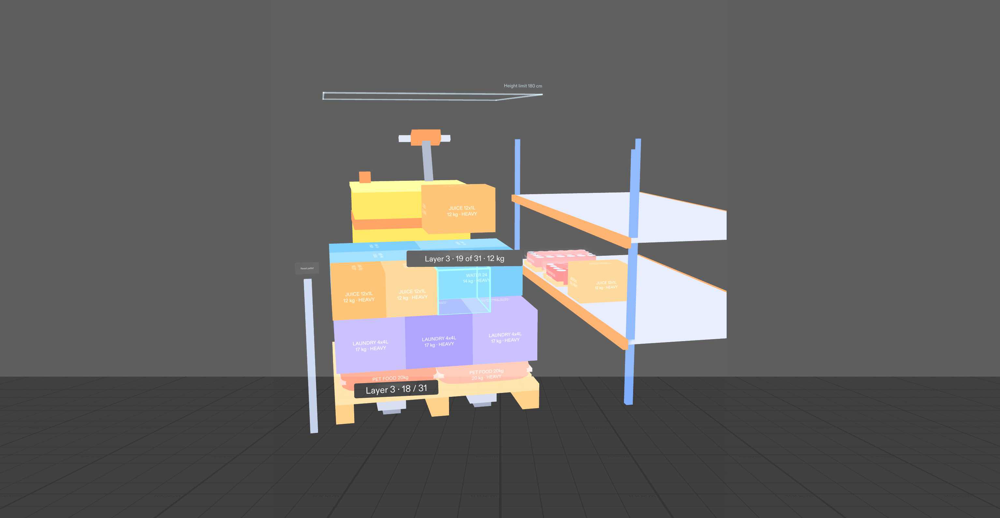

# Stack Right

A pallet-building trainer for new pickers in a supermarket distribution centre, built for SPECS with Lens Studio and CLAD.

The warehouse system already sends a picker's cases heaviest-first. What it doesn't tell you is **where** each odd-sized case goes. A real store order is 100+ cases, and if an early layer goes down with gaps, the pallet starts to lean eighty cases in, and every layer above makes it worse. Stack Right shows the right spot for every case, at real size, on the pallet in front of you.

## Judge it in 90 seconds

| What | Where |
|---|---|
| Demo video (under 3 min) | _link added at submission_ |
| Design brief (plan-lens, approved) | [devpost/design-brief.md](devpost/design-brief.md) |
| Interview answers the brief was built from | [devpost/interview-answers.md](devpost/interview-answers.md) |
| Prompts sent to CLAD | [devpost/agent-logs/](devpost/agent-logs/) (`run_*.sh` are the exact prompts, `*.jsonl` the full transcripts) |
| Test results | [devpost/selftest-2026-11-09.log](devpost/selftest-2026-11-09.log): self-test 76/76, LEAF 7/7 |
| LEAF scenarios | [Assets/Tests/](Assets/Tests/) (copies in [devpost/leaf-scenarios/](devpost/leaf-scenarios/)) |
| Screenshots from the preview | [devpost/screenshots/](devpost/screenshots/) |

## What it does

- **Real scale.** An Australian standard pallet (116.5 x 116.5 cm) on the floor 1 m ahead; a pick face 1.4 m to the right holding the next cases of a 31-case order. The pallet sits on the forks of a ride-on pallet jack, as it would on a real pick run (scenery only).
- **One instruction at a time.** Grab the case due now (it glows) and a ghost appears on the pallet where it fits, turned the right way, tagged `Layer 3 · 17 of 31 · 12 kg`. Drop it within 15 cm and it snaps square.
- **Real freight, not tidy cubes.** Pet food sacks (soft, pillow-shaped), laundry and water cartons, juice, shrink-wrapped trays of tins with the tins showing, bread, chips, and one 112 cm paper towel carton. Sizes differ inside a layer, as they do on a real order.
- **The plan is computed, not hand-placed.** Each layer is row-packed from the case sizes: fill a row across the 116.5 cm pallet, start the next row when the next case won't fit, centre it all. Layer 3 puts the big water cases first and the juice fills the strip they leave. Layers 3 and 4 are turned 90° so the joints cross the layer below (the interlock that stops a pallet splitting); the plan is checked for overlaps, staying on the pallet, and level layers.
- **Mistakes say why.** Drop a case on the pallet but not on the ghost and it slides back with a red tip: `Overhang. Keep it inside the edge.` or `That leaves a gap. Drop it on the ghost.` Drop it off the pallet and it just comes back, no mistake.
- **Layer by layer.** Finishing a layer shows what's next and why, e.g. `Layer 2 done. Next layer turns 90° so the joints cross.` or `Layer 3 done. Flat trays next: keep the top level.` A 180 cm height-limit outline stays above the pallet.
- **A scored finish.** The completion card shows cases, layers, height (127 cm), time, and mistakes grouped by rule, then `Wrap and label the pallet.`

## Why glasses

A paper load plan or a picture on a scanner screen has to be turned into a position in your head, case after case, a hundred times an order. Here the answer is the spot itself, and both hands stay on the case.

Warehousing is one of the highest-injury industries: in NSW, transport, postal and warehousing averages 41 claims per 1,000 workers against 28 across all industries ([SafeWork NSW](https://www.safework.nsw.gov.au/your-industry/transport,-postal-and-warehousing/transport-hazardinjury-popover-tiles/top-injuries-in-transport)). Training on a virtual pallet costs no stock and no restacking.

## How it was built

1. **Interview → brief.** `plan-lens` turned the interview answers into a design brief. The learner (a warehouse picker) reviewed it and corrected the premise: orders arrive weight-sequenced and run 100+ cases, so the skill to teach is placement and interlock, not "heavy first". The brief was revised and approved ([design-brief.md](devpost/design-brief.md); both versions are in the git history).
2. **Brief → Lens.** CLAD built the Lens headlessly through the Lens Studio MCP from the approved brief (`claude -p` with the CLAD skills; prompts and transcripts in `devpost/agent-logs/`).
3. **Lens → tests.** Every done criterion in the brief has LEAF scenarios plus an in-Lens self-test driver. Results are logged in `devpost/`.

Scripts: [Assets/Scripts/](Assets/Scripts/) — `StackRightController.ts` (rules), `StackRightPickList.ts` (order and computed layer plan), `StackRightLabelUI.ts`, `StackRightTestDriver.ts`.

## Run it

Open `pallet_lens.esproj` in Lens Studio 5.23+, press Interactive Preview, and click-drag the glowing case from the shelf onto the pallet. WASD moves, right-drag looks around.

## What's proven and what isn't

- **Logic proven** (tests + preview): layout, ghost and tag, snapping, queue, overhang/gap/off-pallet handling, layer interlock, completion and reset.
- **Feel unproven** (needs real Spectacles): carrying real-size cases with hand tracking, comfort over a full 100-case order, readability on the real display. No SPECS device was available; everything was built and tested in the Lens Studio preview.
- **Stand-ins:** the order is fixed and known to the Lens. A real version would scan each case's barcode and anchor to the real pallet.
